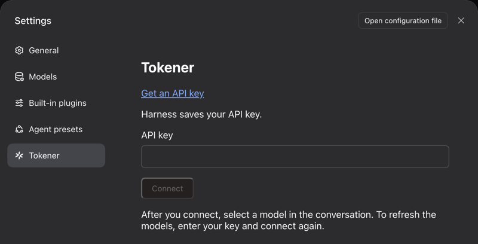

# Tokener provider for DeepSeek Harness

Use [Tokener](https://tokener.ai) models in [DeepSeek Harness](https://github.com/deepseek-ai/deepseek-harness).

## Install

```sh
dsh plugin --profile web add @tokener-ai/dsh-tokener-provider
dsh web
```

1. Open Settings → Tokener.
2. Paste your [Tokener API key](https://tokener.ai) and select Connect.
3. Select a Tokener model in the conversation.



If Tokener is not in Settings, restart Harness. To refresh the models, enter your API key and connect again.

## Update

In Harness, open Plugins → Tokener → Versions and select Update. For a beta version, select Show prereleases first.

From the command line, name the version, then restart Harness:

```sh
dsh plugin --profile web add @tokener-ai/dsh-tokener-provider@<version>
```

Without a version, the command can skip a release that is less than one day old.

## Your API key

Your API key goes only to Tokener. Harness saves it. Do not assume that Harness encrypts it.

## Uninstall

```sh
dsh plugin --profile web remove @tokener-ai/dsh-tokener-provider
```

Harness keeps your saved Tokener models and API key. To remove the models, delete the Tokener entries in Settings → Models. To stop the key from working, revoke it in your [Tokener account](https://tokener.ai).

## License

[MIT](LICENSE)
